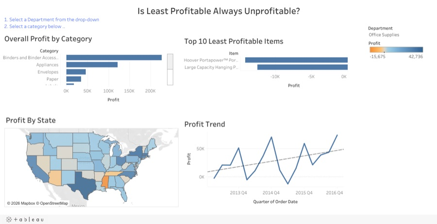

# Superstore Profit Analysis Dashboard

An interactive Tableau dashboard for exploring Superstore profit by department, category, item, state, and quarter. The dashboard focuses on the question **“Is Least Profitable Always Unprofitable?”**

## Dashboard

Use the department filter, then select a category and item to explore the connected views.

- **Overall Profit by Category** compares profit across product categories.
- **Top 10 Least Profitable Items** highlights items with the lowest profit.
- **Profit by State** maps geographic differences, including negative and positive values.
- **Profit Trend** shows quarterly profit from 2013 Q4 through 2016 Q4.

[Open the interactive dashboard on Tableau Public](https://public.tableau.com/app/profile/mohammed.rawther/viz/ProfitAnalysisofDifferentDepartmentofaSuperstore/IsLeastProfitaleAlwaysUnprofitable)

## Tools

- Tableau Desktop for dashboard development
- Tableau Public for interactive publishing and exploration

## Author

Mohammed Rawther · [Tableau Public profile](https://public.tableau.com/app/profile/mohammed.rawther) · [GitHub](https://github.com/Rawther-007)
